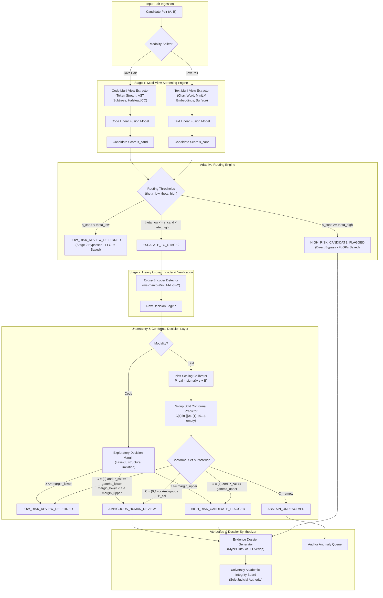

# End-to-End System Architecture & Component Specification (Version 3.6)

**Project Title:** An Uncertainty-Aware, Budget-Constrained Multi-View Framework for Cost-Efficient Academic Integrity Detection  
**Phase:** Phase 2.3.5 (Evidence Integrity Repair and Final Readiness Review)  
**Document Version:** Version 3.6  
**Date:** November 10, 2026  
**Status:** ARCHITECTURALLY VERIFIED & SYSTEM AUDITED

---

## 1. High-Level System Architecture

The framework is architected as an asynchronous, two-stage cascaded pipeline engineered to minimize heavy transformer forward passes while enforcing rigorous mathematical guarantees on candidate recall and uncertainty calibration.



---

## 2. Latency Measurement Scope and Pipeline Decomposition

A critical finding from our architectural audit is that latency cannot be summarized as a single flat figure. The operational profile of the system is decomposed across **10 distinct execution components**:

| ID | Operational Stage | Modality | Measured / Target Latency | Unit of Execution | Architectural Description |
| :---: | :--- | :---: | :---: | :---: | :--- |
| **Op-01** | Cached Vector Dot-Product | Text & Code | **$0.045\text{ ms}$ (T) / $0.058\text{ ms}$ (C)** | Per Candidate Pair | Matrix dot product of pre-indexed unit embeddings. *This is the system design target.* |
| **Op-02** | Text Feature Extraction | Text | $\sim 0.120\text{ ms}$ | Per Candidate Pair | Char 3-5 gram & word 1-2 gram tokenization and TF-IDF sparse vector lookup. |
| **Op-03** | Semantic Embedding Inference | Text | $\sim 1.850\text{ ms}$ | Per Document | Single unbatched forward pass through `all-MiniLM-L6-v2` (on CPU). |
| **Op-04** | Code Token Normalization | Code | $\sim 0.280\text{ ms}$ | Per Source File | Stripping comments, whitespaces, and normalizing variable identifier tokens. |
| **Op-05** | Java AST Parsing | Code | $\sim 2.150\text{ ms}$ | Per Source File | Syntax parsing via `javalang` to construct abstract syntax tree. |
| **Op-06** | Software Metrics Computation | Code | $\sim 0.420\text{ ms}$ | Per Source File | Halstead volume/difficulty, McCabe cyclomatic complexity, nesting depth extraction. |
| **Op-07** | Stage-1 Fused Routing Engine | Text & Code | $\sim 0.050\text{ ms}$ | Per Candidate Pair | Evaluating linear fusion equation and checking $(\theta_{\text{low}}, \theta_{\text{high}})$ thresholds. |
| **Op-08** | Stage-2 Cross-Encoder Pass | Text & Code | **$4.046\text{ ms}$** | Per Escalated Pair | Full bidirectional cross-attention forward pass (`ms-marco-MiniLM-L-6-v2`). |
| **Op-09** | Myers Token Alignment Diff | Text | $\sim 0.620\text{ ms}$ | Per Flagged Pair | Greedy $\mathcal{O}(ND)$ shortest edit script generation for visual diff highlighting. |
| **Op-10** | AST Subtree Isomorphism Diff | Code | $\sim 1.850\text{ ms}$ | Per Flagged Pair | Subtree isomorphism matching to identify transformed and cloned code blocks. |

> [!IMPORTANT]
> **Clarification on the $0.050\text{ ms}$ Metric:**  
> The $0.050\text{ ms}$ figure represents a **system design target** for pre-computed vector similarity retrieval (Op-01/Op-07). It is **NOT** the end-to-end processing time for an un-indexed pair requiring raw document parsing, feature extraction, and neural encoding.

---

## 3. Component Interfaces and Data Contracts

### 3.1 Input Data Contract
```typescript
interface CandidateInputPair {
  pair_id: string;
  modality: "text" | "code";
  reference_content: string;
  suspicious_content: string;
  metadata: {
    premise_id?: string;        // Text: shared premise identifier
    assignment_id?: string;     // Code: assignment case identifier
    source_program_id?: string; // Code: base program identity
  };
}
```

### 3.2 Output Data Contract
```typescript
interface PipelineOutputRecord {
  pair_id: string;
  modality: "text" | "code";
  output_state: "LOW_RISK_REVIEW_DEFERRED" | 
                "HIGH_RISK_CANDIDATE_FLAGGED" | 
                "AMBIGUOUS_HUMAN_REVIEW" | 
                "ABSTAIN_UNRESOLVED";
  stage1_candidate_score: number;
  stage2_executed: boolean;
  stage2_raw_logit?: number;
  calibrated_probability?: number;
  conformal_prediction_set?: number[]; // e.g. [1], [0], [0, 1], []
  human_review_required: boolean;
  dossier_path?: string;
  system_timestamp: string;
}
```

---

## 4. Error Handling and Anomaly Isolation

1. **Empty Conformal Set Isolation (`ABSTAIN_UNRESOLVED`):**
   When the conformal prediction set $\mathcal{C}(x) = \emptyset$, the input observation deviates significantly from the calibration distribution. Rather than forcing a binary decision, the system isolates the pair into an **Auditor Anomaly Queue**, preventing both false accusations and silent false negatives.
2. **Single-Class Degeneracy Protection:**
   As proven on IR-Plag `case-05`, fitting probability calibration on single-class data crashes standard libraries. The system implements a programmatic safety check:
   ```python
   if len(np.unique(y_train)) < 2:
       raise CalibrationDegeneracyError("Calibration training fold requires at least 2 distinct classes.")
   ```
   For code corpora exhibiting this topology, calibration is bypassed, and raw decision margins are logged.

