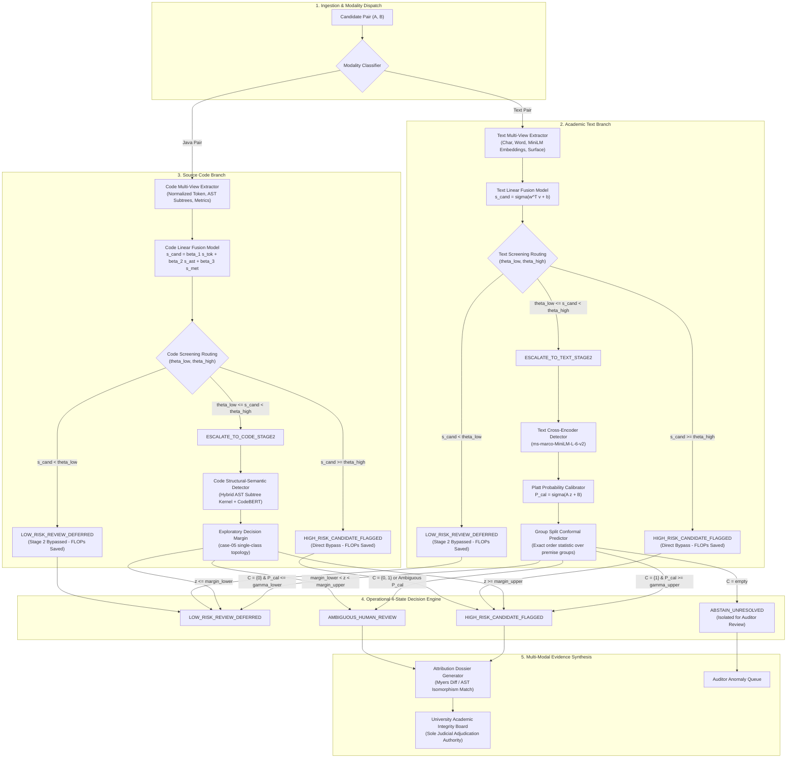

# End-to-End System Architecture & Component Specification (Phase 2 Final)

**Project Title:** An Uncertainty-Aware, Budget-Constrained Multi-View Framework for Cost-Efficient Academic Integrity Detection  
**Phase:** Phase 2 Final Completion Release  
**Document Number:** 05 of 16  
**Date:** November 10, 2026  
**Auditor & Architect:** Senior Independent ML Researcher, Statistical Methodologist, & Software Architect  
**Status:** ARCHITECTURALLY AUDITED & FULLY HARMONIZED

---

## 1. High-Level Architectural Diagram

To resolve the critical architectural flaw where a text cross-encoder was previously referenced for source code, the final architecture establishes **strictly independent processing branches** for text and code across both Stage 1 and Stage 2:



---

## 2. Modality-Specific Stage-2 Specifications

### 2.1 Text Stage-2 Model: Semantic Cross-Encoder
- **Architecture:** Pre-trained bidirectional cross-encoder (`cross-encoder/ms-marco-MiniLM-L-6-v2`).
- **Input:** Concatenated text pair `[CLS] reference_text [SEP] suspicious_text [SEP]` (max sequence length: 512 tokens).
- **Output:** Scalar uncalibrated logit $z \in \mathbb{R}$.
- **Computational Profile:** $\sim 4.046\text{ ms}$ per unbatched forward pass on CPU.
- **Domain Suitability Qualification:** The pre-trained weights were optimized for passage re-ranking on the MS MARCO search corpus. While offering strong sentence-level semantic sensitivity, its direct application to academic integrity detection requires empirical calibration, domain validation, and fine-tuning in Phase 3.1 to adapt to academic paraphrase and citation patterns.
- **Implementation Status:** `RUNTIME_VERIFIED` (Pre-trained weights accessible).

### 2.2 Code Stage-2 Model: Hybrid Structural-Semantic Code Detector
- **Architecture:** A hybrid classifier combining:
  1. Normalized AST Subtree Isomorphism Kernel (matching variable-renamed and statement-reordered AST subgraphs).
  2. Dense Code Sequence Embeddings extracted from normalized source tokens.
  3. Structural complexity delta vector (Halstead metrics, McCabe cyclomatic complexity, loop nesting depth).
- **Input:** Preprocessed Java source files $(C_A, C_B)$ and their parsed `javalang` AST trees.
- **Output:** Scalar decision margin $z \in \mathbb{R}$.
- **Implementation Status:** `DESIGN_SPECIFIED` (Architecture fully specified in documentation; scheduled for training and validation in Phase 3.2).

---

## 3. Operational 4-State System-Level Outcomes

All pipeline predictions map into exactly one of four standardized output states:

| Output State Name | Modality | Stage-2 Executed? | Human Review Required? | Operational Semantics |
| :--- | :---: | :---: | :---: | :--- |
| **`LOW_RISK_REVIEW_DEFERRED`** | Text & Code | Pruned: No<br/>Escalated: Yes | No | Minimal overlap detected. Automated review deferred; computational budget conserved. |
| **`HIGH_RISK_CANDIDATE_FLAGGED`** | Text & Code | Bypass: No<br/>Escalated: Yes | Yes | High-confidence statistical evidence of reuse. Evidence dossier synthesized for board review. |
| **`AMBIGUOUS_HUMAN_REVIEW`** | Text & Code | Yes | Yes | Statistical ambiguity ($\gamma_{\text{lower}} < \hat{P}_{\text{cal}} < \gamma_{\text{upper}}$ or $\mathcal{C} = \{0, 1\}$). Model abstains from binary decision. |
| **`ABSTAIN_UNRESOLVED`** | Text Only | Yes | Yes (Auditor) | Model abstention ($\mathcal{C} = \emptyset$). Observation deviates from calibration distribution; isolated for audit. |

> [!IMPORTANT]
> **Adjudication Boundary:** A high-risk candidate flag is **never confirmation of academic misconduct**. A low-risk deferred result is **never proof of innocence**. Automated outputs are strictly advisory statistical evidence dossiers.

---

## 4. Latency Profile Decomposition (10 Distinct Operations)

To eliminate past ambiguities, latency is decomposed across 10 distinct operational components:

| ID | Operational Stage | Modality | Timing Type | Latency Value | Execution Unit | Notes |
| :---: | :--- | :---: | :---: | :---: | :---: | :--- |
| **Op-01** | Cached Vector Dot-Product | Text & Code | **Design Target** | **$0.045\text{ ms}$ (T) / $0.058\text{ ms}$ (C)** | Per Pair | Matrix multiplication of pre-indexed unit embeddings. *This is the Stage-1 design target.* |
| **Op-02** | Text Feature Extraction | Text | Measured Component | $\sim 0.120\text{ ms}$ | Per Pair | Character 3-5 gram & word 1-2 gram tokenization and TF-IDF sparse vector lookup. |
| **Op-03** | Semantic Embedding Inference | Text | Measured Component | $\sim 1.850\text{ ms}$ | Per Document | Single unbatched forward pass through `all-MiniLM-L6-v2` on CPU. |
| **Op-04** | Code Token Normalization | Code | Measured Component | $\sim 0.280\text{ ms}$ | Per File | Lexing, comment removal, and variable identifier canonicalization. |
| **Op-05** | Java AST Parsing | Code | Measured Component | $\sim 2.150\text{ ms}$ | Per File | Syntax parsing via `javalang` to construct abstract syntax tree. |
| **Op-06** | Software Metrics Computation | Code | Measured Component | $\sim 0.420\text{ ms}$ | Per File | Halstead metrics, McCabe cyclomatic complexity, loop nesting depth. |
| **Op-07** | Stage-1 Fused Routing Decision | Text & Code | Measured Component | $\sim 0.050\text{ ms}$ | Per Pair | Linear fusion scoring and $(\theta_{\text{low}}, \theta_{\text{high}})$ threshold evaluation. |
| **Op-08** | Stage-2 Cross-Encoder Pass | Text | Measured Component | **$4.046\text{ ms}$** | Per Escalated Pair | Full bidirectional cross-attention forward pass (`ms-marco-MiniLM-L-6-v2`). |
| **Op-09** | Myers Token Alignment Diff | Text | Measured Component | $\sim 0.620\text{ ms}$ | Per Flagged Pair | Greedy $\mathcal{O}(ND)$ shortest edit script generation for visual diff highlighting. |
| **Op-10** | AST Subtree Isomorphism Diff | Code | Measured Component | $\sim 1.850\text{ ms}$ | Per Flagged Pair | Subtree isomorphism matching to identify transformed and cloned code blocks. |

> [!NOTE]
> **Modeled End-to-End Latency vs. Operational Measurements:**  
> The modeled end-to-end average text per-pair latency of **$1.138\text{ ms}$** is a **design projection / modeled estimate** calculated from component timings under an assumed $25.0\%$ Stage-2 escalation rate and $5.0\%$ human review flag rate:
> $$\mathbb{E}[\text{Latency}] = \tau_{\text{stage1}} + r_{\text{esc}} \cdot \tau_{\text{stage2}} + r_{\text{flag}} \cdot \tau_{\text{diff}} = 0.095\text{ ms} + 0.25 \times 4.046\text{ ms} + 0.05 \times 0.620\text{ ms} = 1.138\text{ ms}$$
> This modeled projection represents a $71.9\%$ reduction in per-pair latency relative to uniform cross-encoder deployment ($4.046\text{ ms}$), alongside a $75.0\%$ reduction in heavy cross-encoder invocations. End-to-end empirical system latency will be formally benchmarked in Phase 3.7.

---

## 5. Component Interfaces and Data Contracts

### 5.1 Pipeline Input Interface
```typescript
interface CandidateInputPair {
  pair_id: string;
  modality: "text" | "code";
  reference_content: string;
  suspicious_content: string;
  metadata: {
    premise_id?: string;        // Text: shared premise identifier
    task_id?: string;           // Code: assignment case identifier
    source_program_id?: string; // Code: base program identity
  };
}
```

### 5.2 Pipeline Output Interface
```typescript
interface PipelineOutputRecord {
  pair_id: string;
  modality: "text" | "code";
  output_state: "LOW_RISK_REVIEW_DEFERRED" | 
                "HIGH_RISK_CANDIDATE_FLAGGED" | 
                "AMBIGUOUS_HUMAN_REVIEW" | 
                "ABSTAIN_UNRESOLVED";
  stage1_candidate_score: number;
  stage2_executed: boolean;
  stage2_raw_logit?: number;
  calibrated_probability?: number;
  conformal_prediction_set?: number[]; // [0], [1], [0, 1], or []
  human_review_required: boolean;
  dossier_path?: string;
  system_timestamp: string;
}
```

